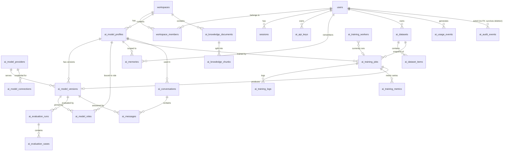

# OMNIX Personal AI — Database

PostgreSQL 16 + pgvector (≥ 0.5 for HNSW; verified with 0.6.0). Six
migrations in `db/migrations/`, each with a `.down.sql` rollback, applied by
`scripts/migrate.mts`.

## 1. Was the existing database used?

No existing **OMNIX** database exists anywhere this project could reach (see
`AI_MODEL_ARCHITECTURE.md` §1). The three databases that do exist belong to
other products (a queue-ticketing app, an empty project named «دوري», and
Mubayn), so nothing was written into them. The schema below is new, and it is
written so that it can be applied to *your* PostgreSQL — Supabase, Neon or
self-hosted — once you choose one.

If OMNIX later gets an existing database with its own `users` / `workspaces`,
apply only `0002`–`0005` after mapping `users.id` and `workspaces.id` to the
existing tables (§6).

## 2. Entity relationships



## 3. Tables

### The 15 tables from the brief

| Brief | Table | Notes |
| --- | --- | --- |
| 1 | `ai_model_profiles` | Identity and behaviour as **typed columns** (name, slug, language, personality, system prompt, temperature, precision, length, knowledge mode, memory, tool limit); only secondary settings in `configuration` jsonb, validated by zod. `UNIQUE (workspace_id, slug)`. |
| 2 | `ai_model_versions` | Semver `CHECK`, base model + revision, provider + provider model name, adapter path/name, `training_job_id`, snapshot of identity config. **At most one `deployed` per model** (partial unique index). **Deploy gate trigger** (§5). |
| 3 | `ai_model_providers` | `owner_id NULL` = platform provider from server env; user providers must be `https://`. Health columns. |
| 4 | `ai_model_connections` | `secret_reference` is a pointer `env:OMNIX_PROVIDER_SECRET_*` (platform admins only, enforced by RLS) or an AES-256-GCM sealed value `enc:v1:…`; a `CHECK` rejects anything else. Never a raw key. |
| 5 | `ai_datasets` | Status, counts, rights statement + confirmation time, last validation report, snapshot hash. |
| 6 | `ai_dataset_items` | Chat record (jsonb, ≤ 64 KB), item hash for de-duplication, source, **consent flag required for conversation-derived items** (`CHECK`), validation status/errors, split. |
| 7 | `ai_training_jobs` | Dataset snapshot hash + summary, base model + revision, method, hyper-parameters, status (`queued/claimed/running/succeeded/failed/cancelled/unavailable`), progress, metrics, hardware, worker, heartbeat, artifact, result version, timestamps. |
| 8 | `ai_knowledge_documents` | Owner, workspace, filename, title, MIME (allow-list), size (≤ 25 MB), sha256 (`UNIQUE` per workspace), storage path, tags, category, processing status, revision. |
| 9 | `ai_knowledge_chunks` | Content, Arabic-normalised `search_text` + generated `tsvector`, metadata (page, heading), **dimension-agnostic `embedding` with `embedding_model` + `embedding_dims`** (§4). |
| 10 | `ai_evaluation_runs` | Type, suite version, status, per-category results, counts (passed/total/skipped), score. |
| 11 | `ai_evaluation_cases` | Input, expected, actual, score, `passed` (NULL = skipped, never counted as pass), latency, detail. |
| 12 | `ai_conversations` | Owner, workspace, model, title, archive flag. |
| 13 | `ai_messages` | Role, content, status (`complete/streaming/cancelled/error`), version, parent (regeneration), sources jsonb, usage, rating, feedback. `owner_id` is set **by a trigger** from the conversation, so it cannot be spoofed. |
| 14 | `ai_usage_events` | Operation, tokens, **`usage_source` (`provider` or `estimate`)**, latency, `estimated_cost` **NULL unless a price is configured**. |
| 15 | `ai_audit_events` | Append-only (UPDATE/DELETE/TRUNCATE raise); `actor_id` has no FK so history survives user deletion. |

### Tables added because the design needed them

| Table | Why |
| --- | --- |
| `users`, `workspaces`, `workspace_members`, `sessions` | OMNIX had no identity tables to reuse. |
| `ai_api_keys` | External applications and OMNIX modules (only a SHA-256 of the key is stored). |
| `rate_limit_buckets` | Rate limits shared across instances. |
| `ai_model_roles` | "Default / Coding / Reasoning / Arabic / Personal assistant" bound to a model, an optional pinned version and real overrides. |
| `ai_memories` | Long-term memory is separate from the knowledge base (the brief requires that). |
| `ai_training_logs`, `ai_training_metrics` | Live logs and the loss / LR / GPU time series for charts. |
| `ai_training_workers` (0004) | Truthful GPU availability before a job is queued; GPU monitoring. |

## 4. Embeddings without mixing dimensions

`embedding` is an untyped `vector`; every row records `embedding_model` and
`embedding_dims`, and a `CHECK (vector_dims(embedding) = embedding_dims)`
guarantees they agree. Each supported model has its **own partial HNSW index
on a dimension cast**:

```sql
CREATE INDEX … USING hnsw ((embedding::vector(384)) vector_cosine_ops)
  WHERE embedding_model = 'intfloat/multilingual-e5-small';
CREATE INDEX … USING hnsw ((embedding::vector(1024)) vector_cosine_ops)
  WHERE embedding_model = 'BAAI/bge-m3';
```

Queries always filter by model, so a 384-d query is never compared with a
1024-d vector. Switching models = set `EMBEDDING_MODEL`, then
*Knowledge → Re-index all*. Adding a third model = one migration with its
partial index plus one registry entry.

## 5. Constraints enforced by PostgreSQL itself

- **Row level security** is `ENABLE`d and `FORCE`d on every user-data table.
  Policies are written against `omnix_current_user_id()`, which reads the
  transaction-local setting `app.user_id`. Without it, every query returns
  zero rows (tested).
- **Roles.** Migrations run as an owner role. The app connects as a login
  role that is a member of `omnix_app` and owns nothing; it refuses to start
  in production if that role is superuser or `BYPASSRLS`. The Python worker
  uses `omnix_worker`, which can read datasets and write job progress but
  cannot read messages, memories or users (tested).
- **Pre-authentication lookups** (login, session, API key) are narrow
  `SECURITY DEFINER` functions with a fixed `search_path`, owned by the
  NOLOGIN role `omnix_definer`, which has explicit grants and RLS policies on
  exactly the tables they read (0006). No login role can act as it (tested).
  They therefore work whether or not the migration role has `BYPASSRLS`.
  `omnix_pending_work()` (0005) returns only ids and owners.
- **Deploy gate.** A `BEFORE INSERT OR UPDATE OF status` trigger refuses
  `status = 'deployed'` unless a `full` evaluation run for that version is
  `passed` and recorded all its cases.
- **Privilege-escalation guards.** Column-level `GRANT UPDATE` on `users`
  excludes `is_platform_admin`; the insert policy forbids creating an admin.
- `CHECK`s on every status enum, length, size, semver, hash format and
  numeric range; foreign keys with deliberate `CASCADE` / `SET NULL` /
  `RESTRICT`; composite FKs `(model_profile_id, owner_id)` so child rows can
  never point at another user's model; indexes on every FK and list query.

## 6. Applying to your database

**Local** (what the tests use):

```bash
scripts/dev-db.sh omnix_dev          # roles + database + pgvector (needs a superuser)
MIGRATION_DATABASE_URL=postgres://omnix_owner:…@localhost/omnix_dev npm run db:migrate
```

**Supabase.** Enable `vector` (Database → Extensions). Run migrations with
the `postgres` connection string (it has `BYPASSRLS`, needed for backups).
Create the app login role once:
`CREATE ROLE omnix_app_login LOGIN PASSWORD '…' IN ROLE omnix_app;` and use it
in `DATABASE_URL`. The app does not use Supabase Auth or PostgREST; the
`anon`/`authenticated` roles get no grants on these tables, and the service
role key is never used by the browser.

**Neon.** Same steps; the project owner role can create roles and the
`vector` extension.

**Merging into an existing OMNIX schema.** Skip `0001`, create the two roles,
and replace the `REFERENCES users (id)` / `workspaces (id)` targets with the
existing tables; the RLS functions only need a way to answer "which user is
this request" (`app.user_id`) and "is this user a member of this workspace".

## 7. Migrations

| File | Adds |
| --- | --- |
| `0001_core` | roles, users, workspaces, members, sessions, API keys, rate limits, auth functions, RLS |
| `0002_ai_model` | all AI tables, pgvector indexes, deploy gate, append-only audit, platform-provider functions, RLS |
| `0003_message_ordering` | `clock_timestamp()` defaults so messages written in one transaction keep a strict order |
| `0004_training_workers` | worker registry for GPU availability and monitoring |
| `0005_background_work` | `omnix_pending_work()` and stale-work recovery for the Node worker |
| `0006_definer_role` | SECURITY DEFINER functions move to a dedicated NOLOGIN role `omnix_definer` with explicit grants and policies, so they work when the migration role lacks `BYPASSRLS` (common on managed PostgreSQL). Before this, sign-in failed on such hosts — found by a portability test, see `tests/integration/portability.test.ts`. |

`npm run db:migrate` takes a `pg_dump` backup before changing an existing
schema (and refuses to proceed if the dump fails), checks pgvector first,
records a checksum per migration and refuses edited migrations.
`npm run db:rollback` undoes the most recent migration (refused in
production without `--i-understand-this-destroys-data`). The full cycle
up → down → up was run on PostgreSQL 16.15 + pgvector 0.6.0.
